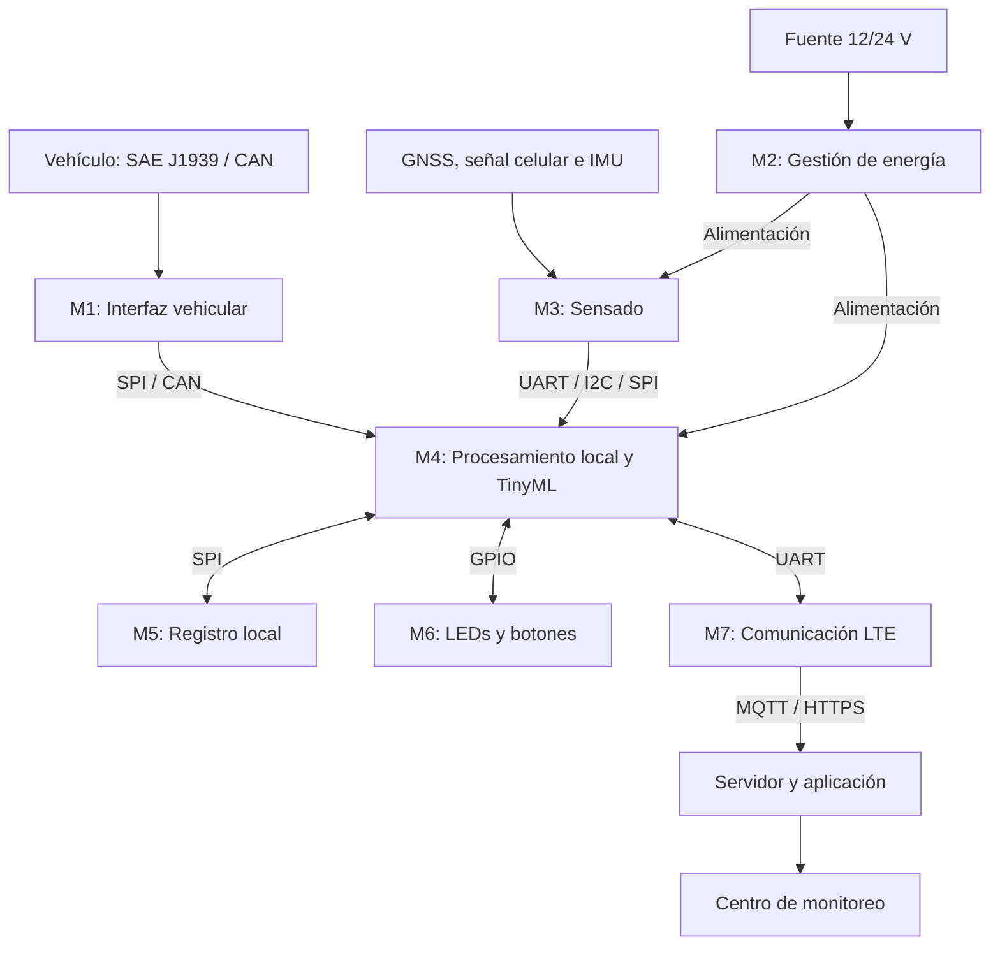
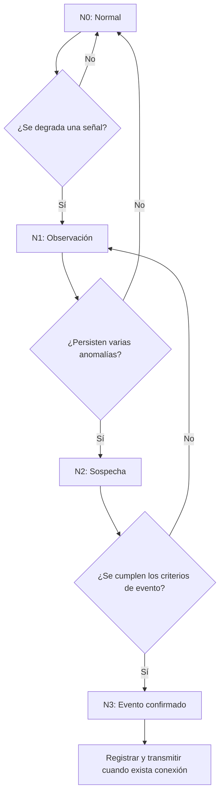

# Diseño de producto: PDS y arquitectura del sistema

!!! info "Objetivo de la semana"
    Transformar la propuesta de valor de Nervik en requisitos técnicos medibles y definir una arquitectura que permita comprender cómo se relacionan el hardware, el procesamiento local, el registro de información y la aplicación.

---

## 1. Introducción

Durante las semanas anteriores analizamos el problema que busca resolver Nervik, la propiedad intelectual relacionada con el producto y las características del mercado al que queremos dirigirnos.

En esta semana comenzamos a definir **cómo deberá funcionar técnicamente nuestro dispositivo**.

Para ello utilizamos dos herramientas principales:

- **Product Design Specification (PDS):** documento que establece los requisitos medibles del producto.
- **Arquitectura del sistema:** representación de los módulos que integran Nervik y de las conexiones entre ellos.

El propósito fue pasar de una idea general a una propuesta técnica que pudiera utilizarse como referencia para el diseño, la selección de componentes y las pruebas posteriores.

---

## 2. Definición técnica de Nervik

Nervik es un dispositivo electrónico orientado al monitoreo de vehículos de transporte de carga.

La propuesta consiste en analizar información del sistema de posicionamiento, la comunicación celular y los datos disponibles del vehículo para identificar condiciones anómalas.

Uno de los objetivos principales es que el dispositivo pueda **continuar procesando y registrando información aunque se pierda la conectividad externa**.

Cuando se restablezca la comunicación, los eventos almacenados podrían enviarse al sistema de monitoreo para su revisión.

### 2.1 Funciones principales

| Función | Descripción |
|:---|:---|
| Monitoreo GNSS | Obtener ubicación e información relacionada con la calidad de señal |
| Comunicación celular | Supervisar la disponibilidad de conectividad |
| Lectura CAN/J1939 | Obtener información del vehículo sin intervenir en sus controles |
| Procesamiento local | Analizar señales y determinar si existe una condición anómala |
| Registro de eventos | Conservar información durante interrupciones de comunicación |
| Generación de alertas | Clasificar eventos y enviarlos cuando exista conectividad |
| Interfaz de usuario | Mostrar el estado del dispositivo y permitir una autoprueba |

### 2.2 Exclusiones del diseño

Como parte de la definición del producto, el equipo estableció que Nervik no debe:

- Detener o bloquear el motor.
- Actuar sobre frenos, dirección o transmisión.
- Enviar instrucciones de control al vehículo.
- Decidir automáticamente cambios de ruta.
- Depender de la nube para realizar la detección local.

Estas restricciones son importantes porque el dispositivo busca complementar los sistemas de seguridad existentes, sin introducir nuevas acciones sobre la operación del camión.

---

## 3. Especificación de Diseño de Producto (PDS)

El PDS permite convertir las necesidades del usuario en requisitos que puedan verificarse mediante pruebas.

A diferencia de una descripción general, cada requisito debe establecer qué se espera del producto y cómo se comprobará su cumplimiento.

### 3.1 Desarrollo del PDS

El equipo comenzó con restricciones relacionadas con:

- Condiciones ambientales.
- Dimensiones de la carcasa.
- Costo de prototipado.
- Facilidad de instalación.
- Alimentación eléctrica.
- Seguridad y comunicación.

En una primera aproximación se consideraron dimensiones máximas de 150 × 100 × 50 mm y un presupuesto de prototipo de $2,500 MXN por unidad.

Posteriormente, se desarrolló el **PDS v1.0**, más específico, con 56 requisitos distribuidos en diez categorías.

Los requisitos incluyen valores objetivo, prioridades y métodos de verificación.

### 3.2 Requisitos de desempeño

| Código | Requisito | Objetivo | Verificación propuesta |
|:---|:---|:---|:---|
| F-01 | Detección de interferencia RF | ≤ 5 s | Prueba controlada de interferencia |
| F-02 | Falsos positivos | ≤ 1 por cada 1,000 km | Pruebas de ruta y bitácora |
| F-03 | Análisis multiseñal | ≥ 3 señales simultáneas | Revisión del firmware |
| F-04 | Inferencia local | ≤ 100 ms por ventana | Medición de tiempo en el microcontrolador |
| F-05 | Operación sin conectividad | Detección y registro sin enlace celular | Prueba con comunicación deshabilitada |
| F-08 | Alertas por niveles | Estados definidos | Prueba de máquina de estados |
| F-09 | Transmisión diferida | Eventos enviados en ≤ 60 s al reconectar | Prueba de reconexión |

Estos objetivos permiten establecer cómo deberá evaluarse el rendimiento del sistema cuando se desarrollen las pruebas.

### 3.3 Requisitos de interfaz

| Código | Requisito | Objetivo |
|:---|:---|:---|
| I-01 | Interfaz vehicular | SAE J1939 sobre CAN 2.0B |
| I-02 | Comunicación con el vehículo | Modo solo escucha, sin transmitir tramas |
| I-03 | Datos vehiculares | Velocidad, RPM, freno, odómetro y combustible |
| I-04 | Comunicación externa | LTE Cat-M1 / NB-IoT y respaldo previsto |
| I-05 | Interfaz local | 3 LED y 2 botones |
| I-06 | Expansión | Puerto reservado para sensor de remolque |

Una corrección importante fue establecer que la interfaz principal para tractocamiones será **SAE J1939 mediante un conector Deutsch de nueve pines**, y no el puerto OBD-II convencional utilizado en muchos automóviles.

### 3.4 Requisitos de alimentación

| Código | Requisito | Objetivo |
|:---|:---|:---|
| E-01 | Tensión de entrada | 9–36 V DC |
| E-02 | Consumo de operación | ≤ 2 W promedio |
| E-03 | Consumo en reposo | ≤ 50 mW |
| E-04 | Respaldo de energía | ≥ 72 horas |
| E-05 | Protección eléctrica | Polaridad, sobretensión y transitorios |
| E-06 | Detección de desconexión | Evento registrado en ≤ 10 s |

La alimentación es uno de los aspectos más importantes de la arquitectura, debido a que el dispositivo se propone para un entorno vehicular.

Por ello, el diseño completo contempla conversión de voltaje, protección eléctrica y una batería de respaldo.

### 3.5 Requisitos de procesamiento y almacenamiento

| Código | Requisito | Objetivo |
|:---|:---|:---|
| P-01 | Microcontrolador | ARM Cortex-M de ≥ 133 MHz y ≥ 264 kB RAM |
| P-02 | Modelo TinyML | Tamaño ≤ 256 kB |
| P-03 | Memoria de registro | Flash ≥ 8 MB |
| P-04 | Integridad de eventos | Firma HMAC-SHA256 |
| P-05 | Protección de bitácora | Evitar modificación o borrado desde interfaces de usuario |
| P-06 | Reloj sin GNSS | Deriva objetivo ≤ 2 s/día |

La finalidad del almacenamiento es conservar información que pueda recuperarse después de una interrupción.

La firma de eventos forma parte de la arquitectura propuesta para mejorar la integridad de los registros.

### 3.6 Requisitos físicos y ambientales

| Código | Requisito | Objetivo |
|:---|:---|:---|
| M-01 | Dimensiones | ≤ 90 × 60 × 25 mm |
| M-02 | Masa | ≤ 150 g con batería |
| M-03 | Geometría | Variante B, cuña biselada |
| M-04 | Material | PETG |
| M-05 | Protección contra ingreso | IP54 deseable |
| A-01 | Temperatura de operación | −10 °C a +70 °C |
| A-02 | Temperatura de almacenamiento | −20 °C a +85 °C |

El tamaño del dispositivo y su instalación discreta condicionan el diseño de la carcasa y la distribución de los componentes electrónicos.

### 3.7 Fiabilidad, costo e instalación

| Categoría | Requisito | Objetivo |
|:---|:---|:---|
| Fiabilidad | Vida útil | 5 años |
| Fiabilidad | Autoprueba | Resultado en ≤ 30 s |
| Costo | BOM en lote de 100 | ≤ $650 MXN por unidad |
| Costo | Manufactura y ensamble | ≤ $250 MXN por unidad |
| Comercial | Precio propuesto | $1,800 instalado + $300 mensuales |
| Instalación | Tiempo requerido | ≤ 10 min |
| Instalación | Intervención al vehículo | Sin cortar cables ni perforar |
| Interfaz | Alta en aplicación | ≤ 5 min |

Los costos y las características anteriores corresponden a metas del PDS, no a resultados de fabricación o validación.

---

## 4. Decisión sobre la arquitectura de inteligencia artificial

Una de las decisiones más importantes del equipo fue definir dónde se ejecutaría el procesamiento inteligente de Nervik.

Se compararon dos posibilidades:

1. Procesar las señales mediante servicios en la nube.
2. Ejecutar el análisis directamente en el dispositivo.

### 4.1 Arquitectura seleccionada: Edge AI

Se decidió utilizar una arquitectura de procesamiento local, también conocida como **Edge AI**.

Esto significa que el microcontrolador analiza los datos sin necesitar una conexión permanente a internet.

### 4.2 Justificación

| Factor | Procesamiento en la nube | Procesamiento local |
|:---|:---|:---|
| Dependencia de internet | Alta | Baja para la detección |
| Detección durante una interrupción | Limitada | Prevista |
| Latencia | Depende de la conexión | Depende del hardware local |
| Costo por inferencia | Puede requerir servicios externos | No requiere pagar cada inferencia |
| Registro durante desconexión | Necesita mecanismos adicionales | Puede integrarse al dispositivo |

### 4.3 Decisión del equipo

Se propuso utilizar un modelo TinyML que funcione en el microcontrolador para clasificar condiciones anómalas.

La comunicación con la nube se reservaría para transmitir eventos, consultar información y generar reportes cuando exista conectividad.

Esta decisión está relacionada con la propuesta de valor de Nervik: mantener funciones importantes cuando el vehículo pierde comunicación.

---

## 5. Arquitectura general del sistema

Para organizar el producto se definieron **siete módulos internos**, además de los sistemas externos con los que se comunicará.

Cada módulo tiene una función específica y se relaciona con los demás mediante interfaces eléctricas o protocolos de comunicación.

### 5.1 Los siete módulos de Nervik

| Módulo | Nombre | Función |
|:---|:---|:---|
| M1 | Interfaz vehicular | Obtener información del bus J1939 |
| M2 | Gestión de energía | Alimentar el dispositivo y gestionar el respaldo |
| M3 | Sensado | Adquirir señales GNSS, celulares y de movimiento |
| M4 | Procesamiento | Analizar información y determinar estados |
| M5 | Registro local | Conservar eventos |
| M6 | Interfaz local | Mostrar estados y permitir autoprueba |
| M7 | Comunicación | Enviar información hacia el sistema externo |

### M1 — Interfaz vehicular

La interfaz vehicular permite que Nervik reciba información del camión mediante CAN/J1939.

La arquitectura considera un transceptor CAN, protecciones eléctricas y un modo de operación de solo escucha.

El dispositivo no debe transmitir comandos que afecten los sistemas del vehículo.

### M2 — Gestión de energía

Este módulo proporciona las tensiones requeridas por los componentes.

La versión integrada considera:

- Entrada nominal de 12/24 V.
- Conversión DC-DC.
- Protección contra inversión de polaridad.
- Protección contra transitorios eléctricos.
- Batería LiFePO₄ de respaldo.

### M3 — Sensado

Se encarga de adquirir información relacionada con el movimiento y el entorno de comunicación.

Incluye:

- Receptor GNSS multiconstelación.
- IMU de seis ejes.
- Información de intensidad y calidad de señal.
- Sensor de manipulación de la carcasa.

### M4 — Procesamiento

Es el núcleo de decisión del dispositivo.

Recibe las lecturas de los demás módulos, ejecuta el firmware, procesa los datos y determina el estado de alerta correspondiente.

Aquí se propone ejecutar el modelo TinyML.

### M5 — Registro local

Este módulo almacena información relevante durante el funcionamiento del dispositivo.

La propuesta contempla memoria flash, bitácora local y mecanismos de integridad para los registros.

Cuando se restablezca la comunicación, la información almacenada podría sincronizarse con la plataforma externa.

### M6 — Interfaz local

Permite identificar rápidamente el estado del dispositivo.

Se contemplan:

- LED de alimentación.
- LED de comunicación.
- LED de alerta.
- Botón de reinicio.
- Botón de autoprueba.

### M7 — Comunicación

Este módulo permite transmitir información al exterior mediante comunicación celular.

La arquitectura propone LTE Cat-M1 / NB-IoT y mecanismos de reintento cuando exista una pérdida temporal de conectividad.

La comunicación externa no debe ser indispensable para que el procesamiento y el registro local continúen funcionando.

---

## 6. Interfaces y protocolos

Definir las interfaces permite identificar cómo se conectarán los módulos y qué características debe tener el hardware.

| Interfaz | Comunicación | Protocolo |
|:---|:---|:---|
| IF-1 | Vehículo → M1 | CAN 2.0B / SAE J1939 |
| IF-2 | M1 → M4 | SPI o controlador CAN integrado |
| IF-3 | Sensores → M4 | UART, I²C y SPI |
| IF-4 | M4 ↔ M5 | SPI |
| IF-5 | M4 ↔ M7 | UART y comandos AT |
| IF-6 | M4 ↔ M6 | GPIO |
| IF-7 | M2 → módulos | Alimentación regulada |
| IF-8 | M7 ↔ Nube | MQTT o HTTPS sobre TLS |

### 6.1 Diagrama de arquitectura

El siguiente diagrama resume la relación general entre los módulos previstos.

Este diagrama representa la arquitectura propuesta para Nervik. No corresponde a un circuito eléctrico ni sustituye al esquemático de PCB.

---

## 7. Máquina de estados de alerta

El equipo definió una respuesta gradual ante las anomalías.

La intención es evitar que una única variación de señal genere automáticamente una alerta de máxima prioridad.

### 7.1 Estados definidos

| Estado | Condición | Acción |
|:---|:---|:---|
| N0 — Normal | Señales y comunicación disponibles | Registro periódico |
| N1 — Observación | Degradación de una señal | Aumentar observación y registrar |
| N2 — Sospecha | Degradación de dos o más señales con movimiento | Generar alerta silenciosa o encolar evento |
| N3 — Evento confirmado | Pérdida de GNSS y celular junto con anomalía adicional | Registrar evento y priorizar su transmisión |

Los tiempos objetivo documentados para la respuesta son de hasta 2 segundos en observación y hasta 5 segundos para los estados de mayor prioridad.

En ningún estado se contempla actuar directamente sobre el vehículo.

### 7.2 Flujo general

El flujo ilustra la progresión conceptual de los estados. Las condiciones específicas deberán implementarse y validarse en el firmware.

---

## 8. Trazabilidad entre necesidades y requisitos

La trazabilidad permite relacionar una necesidad del usuario con un requisito técnico y con los módulos responsables de cumplirlo.

| Necesidad | Requisitos | Módulos |
|:---|:---|:---|
| Mantener funciones durante pérdida de señal | F-01, F-03, F-05, E-04 | M3, M4, M5 |
| Reducir falsas alarmas | F-02, F-03, F-08 | M3, M4 |
| Conservar evidencia del incidente | P-03, P-04, P-05 | M4, M5 |
| Facilitar la instalación | U-01, U-02, M-06 | M1, M2 |
| No comprometer la seguridad vehicular | I-02, N-05, N-06 | M1, M4 |
| Mantener un costo comercial competitivo | C-01, C-02, C-03 | Sistema completo |

Esta matriz nos permite comprender que las funciones no se encuentran aisladas.

Por ejemplo, la necesidad de conservar información durante una desconexión requiere sensores, procesamiento, memoria y respaldo de alimentación.

---

## 9. Riesgos identificados

Durante la revisión de la arquitectura se identificaron riesgos que pueden afectar el diseño o la validación del producto.

| Riesgo | Medida propuesta | Prioridad |
|:---|:---|:---|
| Diferencias de J1939 entre vehículos | Validar en distintas marcas y modelos | Alta |
| Exceso de falsas alarmas | Obtener datos reales y ajustar criterios | Alta |
| Módem no homologado | Verificar homologación del proveedor | Alta |
| Baja frecuencia real de incidentes | Entrevistar a responsables de seguridad | Alta |
| Expediente no aceptado por aseguradora | Revisar formato con especialistas | Media |
| Consumo excesivo en reposo | Medir consumo y aplicar modos de bajo consumo | Media |

Uno de los riesgos principales es la validación del algoritmo de detección.

Aunque la arquitectura pueda construirse, demostrar una tasa baja de falsos positivos requiere obtener datos y realizar pruebas representativas.

---

## 10. Investigación preliminar de componentes y costos

En esta semana también se realizó una exploración inicial de componentes con apoyo de Perplexity.

La búsqueda consideró un MVP de diez unidades, incluyendo electrónica, manufactura y recursos de desarrollo.

### 10.1 Resultados preliminares

| Concepto | Costo estimado |
|:---|---:|
| BOM electrónico con GSM | $1,810 MXN por unidad |
| BOM ajustado sin GSM | $1,531 MXN por unidad |
| Carcasa y manufactura en lote de 10 | $1,170 MXN por unidad |
| Desarrollo embebido e IA | $375,000 MXN |
| Aplicación y plataforma web durante seis meses | $185,900 MXN |

La primera lista de materiales consideró ESP32-S3, módulos CAN, comunicación GSM, memoria y otros componentes.

Posteriormente se detectó que esa selección no coincidía completamente con la arquitectura del PDS, especialmente en el microcontrolador y el sistema de comunicación.

Por esa razón, los costos se consideraron preliminares y se planteó una revisión más detallada durante la Semana 7.

---

## 11. Resultados principales

| Actividad | Resultado |
|:---|:---|
| Definición del producto | Funciones y exclusiones documentadas |
| Desarrollo del PDS | Versión 1.0 con 56 requisitos |
| Arquitectura de IA | Procesamiento local mediante Edge AI |
| Arquitectura física | Siete módulos internos |
| Interfaz vehicular | SAE J1939 sobre CAN |
| Estados de alerta | Cuatro niveles definidos |
| Trazabilidad | Necesidades relacionadas con requisitos y módulos |
| Riesgos | Identificación de riesgos técnicos y comerciales |
| Investigación de componentes | Primera estimación de costos |

### Decisiones relevantes

Las principales decisiones de esta semana fueron:

1. Mantener el procesamiento de anomalías dentro del dispositivo.
2. Utilizar J1939 como interfaz principal del vehículo.
3. Exigir una operación de solo escucha.
4. Integrar almacenamiento local para conservar información.
5. Establecer requisitos medibles antes de seleccionar definitivamente los componentes.

---

## 12. Reflexión personal

Esta semana fue especialmente importante para comprender cómo una propuesta tecnológica comienza a convertirse en un diseño de ingeniería.

El PDS permite establecer criterios concretos para decidir qué componentes utilizar y cómo evaluar si cumplen lo esperado.

Desde mi perspectiva, una de las decisiones más relevantes es que Nervik no dependa completamente de la nube.

Si una de las situaciones que queremos detectar implica pérdida de comunicación, el microcontrolador debe poder continuar realizando tareas esenciales de manera local.

También considero fundamental la decisión de utilizar CAN/J1939 exclusivamente para obtener información.

Esto influye directamente en la arquitectura electrónica, ya que el controlador y el transceptor deberán configurarse y verificarse para evitar transmisiones hacia el vehículo.

Finalmente, comprendí que los módulos electrónicos no pueden seleccionarse únicamente por su precio o disponibilidad. Es necesario relacionar cada componente con los requisitos del PDS y con las condiciones en las que se utilizará el producto.

---

## 13. Conclusión

La Semana 5 permitió transformar la propuesta de Nervik en una arquitectura técnica estructurada y en un conjunto de requisitos verificables.

El PDS definió las condiciones que deberán orientar el diseño, mientras que el diagrama de arquitectura permitió identificar las funciones de cada módulo y sus protocolos de comunicación.

Las decisiones sobre Edge AI, almacenamiento local y lectura pasiva del bus vehicular se convirtieron en elementos centrales del producto.

El siguiente paso será utilizar esta arquitectura para desarrollar y seleccionar el concepto físico del dispositivo, relacionando sus dimensiones, forma y distribución de componentes con las necesidades del usuario.

---
