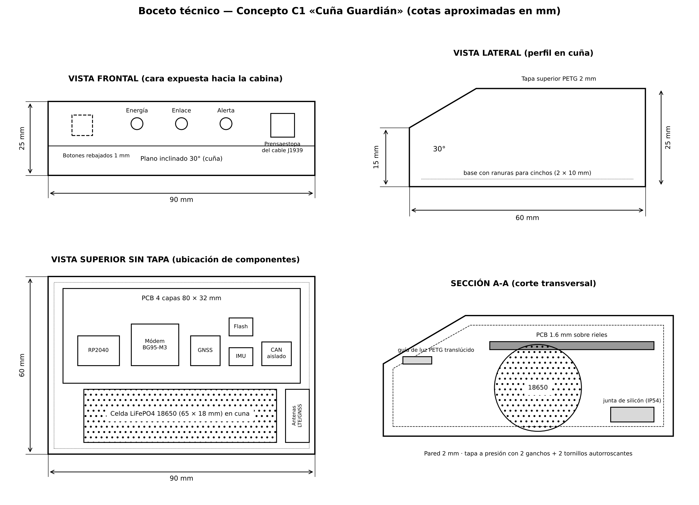

# Generación y selección de concepto de diseño

!!! info "Objetivo de la semana"
    Desarrollar diferentes alternativas de diseño para Nervik, compararlas mediante criterios de deseabilidad y factibilidad, y seleccionar un concepto que cumpla con los requisitos técnicos establecidos en el PDS de la Semana 5.

---

## 1. Introducción

Durante la Semana 5 definimos las especificaciones técnicas y la arquitectura del sistema de Nervik.

En esta semana el trabajo se enfocó en transformar esos requisitos en propuestas concretas de diseño, considerando tanto el dispositivo físico como la experiencia del usuario y la aplicación.

El objetivo fue evitar seleccionar una carcasa únicamente por su apariencia. Para ello, se generaron diferentes conceptos y se compararon mediante una metodología estructurada.

El proceso incluyó el uso de herramientas de inteligencia artificial como apoyo para generar alternativas, investigar soluciones de otros sectores y evaluar los conceptos.

Las principales actividades fueron:

1. Construcción de una tabla morfológica.
2. Búsqueda de analogías tecnológicas.
3. Desarrollo de tres conceptos de diseño.
4. Evaluación mediante una matriz de Pugh.
5. Definición del boceto técnico.
6. Diseño conceptual de la interfaz de usuario.
7. Justificación del concepto seleccionado.

---

## 2. Generación de alternativas mediante una tabla morfológica

La tabla morfológica es una herramienta que permite explorar distintas soluciones para los elementos principales de un producto.

En lugar de desarrollar una sola propuesta desde el inicio, se dividió el diseño en siete parámetros y se plantearon tres alternativas para cada uno.

Se utilizó **Claude** como herramienta de apoyo para generar opciones que pudieran fabricarse con los recursos disponibles en un entorno universitario, como impresión 3D y componentes electrónicos comerciales.

El equipo complementó las propuestas con algunas variantes propias, especialmente relacionadas con la forma de la carcasa.

### 2.1 Tabla morfológica de Nervik

| Parámetro | Alternativa A | Alternativa B | Alternativa C |
|:---|:---|:---|:---|
| Forma de carcasa | Caja rectangular compacta | Cuña biselada | Cápsula redondeada |
| Instalación | Cinta adhesiva automotriz | Soporte con cinchos desmontables | Base atornillada |
| Indicadores | Un LED RGB | Tres LED independientes | Pantalla OLED |
| Material | PLA/PETG mate | PETG liso | ABS/ASA mate |
| Interfaz física | Un botón multifunción | Dos botones: reinicio y prueba | Botón de servicio protegido |
| Alimentación | Solamente alimentación vehicular | 12/24 V con conversión DC-DC | Alimentación vehicular y batería LiFePO4 |
| Protección y ubicación | Oculto bajo el tablero | Compartimento protegido con soporte | Sellos IP54 en la interfaz |

### 2.2 Análisis de las alternativas

La tabla permitió identificar diferentes compromisos entre facilidad de fabricación, protección, instalación y experiencia de uso.

Por ejemplo, una caja rectangular es más sencilla de fabricar, pero una geometría en cuña puede ofrecer ventajas de integración y protección física.

También se compararon diferentes formas de mostrar el estado del dispositivo.

Se consideró que tres LED independientes permitirían identificar claramente funciones distintas:

- Estado de alimentación.
- Estado de comunicación.
- Estado de alerta.

La tabla morfológica sirvió como base para combinar alternativas y generar los tres conceptos que se evaluarían posteriormente.

---

## 3. Analogías tecnológicas

Para ampliar las alternativas se investigaron soluciones utilizadas en otros sectores que enfrentan problemas similares de señalización, protección o conservación de información.

Se utilizó nuevamente Claude como apoyo para identificar principios de diseño que pudieran adaptarse a Nervik.

### 3.1 Referencias estudiadas

| Referencia | Sector | Principio aplicado a Nervik |
|:---|:---|:---|
| Panel de advertencias de un avión | Aeronáutica | Utilizar indicadores separados con significados claros |
| Detector de humo | Seguridad doméstica | Incorporar una señal de funcionamiento y un botón de autoprueba |
| Cámara domo antivandalismo | Seguridad urbana | Evitar superficies que faciliten la manipulación |
| Caja negra de vuelo | Aeronáutica | Priorizar la conservación de información durante un incidente |

### 3.2 Aplicación al diseño

Las analogías ayudaron a desarrollar soluciones que no estaban relacionadas únicamente con la estética de la carcasa.

En particular, se propuso incorporar superficies redondeadas o biseladas que redujeran los puntos de agarre.

También se reforzó la decisión de utilizar indicadores independientes, de manera que el estado del dispositivo pudiera reconocerse sin abrir la aplicación.

A partir de estas referencias se añadió una variante de cuña con aristas redondeadas y chaflanes de 45°.

---

## 4. Desarrollo de los tres conceptos

Con las alternativas de la tabla morfológica se desarrollaron tres propuestas completas.

Cada concepto consideró la forma del dispositivo, sus materiales, el sistema de instalación, la alimentación, los indicadores y su relación con la aplicación.

### 4.1 Concepto 1 — Cuña Guardián

La primera alternativa consiste en una carcasa con forma de cuña biselada a 30°.

Sus principales características son:

- Carcasa fabricada en PETG liso.
- Montaje mediante un soporte y dos cinchos.
- Tres LED independientes.
- Alimentación vehicular con batería de respaldo LiFePO4.
- Diseño orientado a proteger el dispositivo y conservar información.
- Posibilidad de fabricación mediante impresión 3D.

El concepto combina elementos de una caja negra con la señalización clara de un panel aeronáutico.

### 4.2 Concepto 2 — Caja Discreta

La segunda alternativa utiliza una carcasa rectangular compacta.

Sus características son:

- Fabricación en PLA o PETG.
- Instalación mediante cinta adhesiva.
- Un LED RGB como indicador.
- Alimentación exclusivamente vehicular.
- Geometría sencilla y menor complejidad de fabricación.

Esta alternativa se utilizó como **referencia o datum** para la evaluación mediante la matriz de Pugh.

### 4.3 Concepto 3 — Cápsula Lisa

La tercera alternativa plantea una carcasa con superficies redondeadas y apariencia similar a una cápsula.

Sus características principales son:

- Material ABS o ASA.
- Instalación mediante una base atornillada.
- Pantalla OLED.
- Alimentación vehicular con respaldo LiFePO4.
- Superficie exterior diseñada para dificultar la manipulación.

Aunque presenta ventajas de protección y apariencia, también implica mayores dificultades de fabricación.

### 4.4 Comparación general

| Característica | Cuña Guardián | Caja Discreta | Cápsula Lisa |
|:---|:---|:---|:---|
| Forma | Cuña biselada a 30° | Caja rectangular | Cápsula redondeada |
| Montaje | Dos cinchos | Cinta adhesiva | Base atornillada |
| Indicadores | Tres LED | LED RGB | Pantalla OLED |
| Material | PETG liso | PLA/PETG | ABS/ASA |
| Energía | Vehicular + LiFePO4 | Vehicular | Vehicular + LiFePO4 |
| Fabricación | Impresión con plano inclinado | Más sencilla | Requiere mayor control de impresión |
| Analogía principal | Caja negra y panel de avión | Rastreador adhesivo | Domo antivandalismo |

---

## 5. Selección mediante matriz de Pugh

Después de desarrollar los tres conceptos se utilizó una matriz de Pugh para seleccionar la alternativa más adecuada.

Esta herramienta permite comparar diferentes propuestas a partir de criterios previamente definidos, evitando basar la decisión únicamente en preferencias personales.

Para la comparación se utilizó como referencia el **Concepto 2: Caja Discreta**.

Los criterios se dividieron en dos categorías:

- **Deseabilidad:** características importantes para el usuario.
- **Factibilidad:** facilidad de fabricar, ensamblar y desarrollar el producto.

Se utilizaron nueve criterios ponderados. La deseabilidad representó el 45% del peso total.

### 5.1 Matriz de Pugh

| Criterio | Peso | Cuña Guardián | Caja Discreta | Cápsula Lisa |
|:---|:---:|:---:|:---:|:---:|
| Instalación sin herramientas | 15% | S | Ref. | − |
| Estado legible sin aplicación | 12% | + | Ref. | + |
| Resistencia a manipulación | 13% | + | Ref. | + |
| Confianza del acabado | 5% | S | Ref. | + |
| Costo por unidad en lote de 10 | 15% | − | Ref. | − |
| Complejidad de ensamble | 10% | − | Ref. | − |
| Compatibilidad con FDM y JLCPCB | 10% | S | Ref. | − |
| IP54 y temperatura de 60 °C | 10% | + | Ref. | + |
| Tiempo de prototipado | 10% | S | Ref. | − |
| **Puntuación ponderada** | **100%** | **+10** | **0** | **−20** |

**Interpretación de símbolos:**

- **+**: mejor que el concepto de referencia.
- **S**: desempeño similar al concepto de referencia.
- **−**: peor que el concepto de referencia.
- **Ref.**: concepto utilizado como referencia.

### 5.2 Resultados

| Concepto | Resultado |
|:---|---:|
| **C1 — Cuña Guardián** | **+10** |
| C2 — Caja Discreta | 0 |
| C3 — Cápsula Lisa | −20 |

El concepto **Cuña Guardián** obtuvo la puntuación más alta.

Sus principales ventajas estuvieron relacionadas con la legibilidad de los indicadores, la resistencia a manipulación y la protección en condiciones de temperatura elevadas.

La Caja Discreta resultó más sencilla y económica de fabricar, pero no obtuvo las mismas ventajas funcionales.

Por su parte, la Cápsula Lisa presentó dificultades en instalación, manufactura y tiempo de prototipado.

### 5.3 Decisión del equipo

El equipo seleccionó el **Concepto 1 — Cuña Guardián**.

La evaluación también permitió identificar elementos que podían mejorarse antes de continuar el desarrollo.

Se decidió considerar dos características de la Cápsula Lisa:

1. Aristas redondeadas para mejorar la protección física.
2. Junta de silicón para contribuir al objetivo de protección IP54.

El principal riesgo identificado para Cuña Guardián fue su costo de fabricación, que deberá revisarse durante la etapa de diseño para manufactura.

---

## 6. Boceto técnico del concepto seleccionado

Una vez seleccionado el concepto se desarrolló un boceto técnico para establecer su geometría, dimensiones, materiales y distribución interna.

El diseño corresponde a una carcasa compacta con forma de cuña, pensada para instalarse de manera discreta dentro de un vehículo.

### 6.1 Boceto de Cuña Guardián

*Figura 1. Boceto técnico del Concepto Cuña Guardián.*

### 6.2 Dimensiones principales

| Característica | Especificación propuesta |
|:---|:---|
| Largo | 90 mm |
| Ancho | 60 mm |
| Altura máxima | 25 mm |
| Altura mínima | 15 mm |
| Inclinación | 30° |
| Material de carcasa | PETG negro |
| Espesor de pared | 2 mm |

### 6.3 Distribución de componentes

El boceto propone organizar los componentes electrónicos dentro de la carcasa de la siguiente manera:

- PCB de cuatro capas de aproximadamente 80 × 32 mm.
- Sujeción mediante rieles interiores.
- Celda de batería 18650 en una cuna inferior.
- Antenas ubicadas lejos de la batería.
- Prensaestopa lateral para el cable de comunicación J1939.
- Tres indicadores luminosos visibles desde el exterior.

También se considera una tapa con dos ganchos y dos tornillos autorroscantes, de manera que el dispositivo pueda abrirse para mantenimiento o sustitución de la batería.

### 6.4 Materiales y ensamble

El concepto seleccionado contempla PETG negro para la estructura principal, PETG translúcido para las guías de luz, junta de silicón y cinchos de nailon para su instalación.

La intención es que la carcasa sea fabricable mediante impresión 3D, manteniendo un equilibrio entre tamaño, resistencia y facilidad de ensamble.

Estas dimensiones corresponden a la propuesta desarrollada durante esta semana y servirán como referencia para las siguientes etapas de diseño.

---

## 7. Diseño conceptual de la aplicación

La selección del concepto físico también incluyó el desarrollo de propuestas para la interfaz de usuario.

Se utilizaron wireframes para estudiar cómo debería mostrarse la información más importante en la aplicación.

El objetivo fue evitar una interfaz saturada de datos que dificultara identificar un evento de riesgo.

### 7.1 Pantalla de funcionamiento normal

La primera pantalla representa una flota con sus unidades funcionando sin anomalías.

La información principal incluye:

- Número de unidades protegidas.
- Estado general de la flota.
- Mapa de vehículos.
- Lista de unidades y sus estados.
- Acceso a información de un vehículo específico.

El ejemplo documentado muestra una flota de 24 unidades con todas las unidades protegidas.

### 7.2 Pantalla de alerta

La segunda pantalla presenta una situación de riesgo, utilizando como ejemplo una unidad con alerta de Nivel 3.

La información principal incluye:

- Unidad afectada.
- Nivel de alerta.
- Hora de la última comunicación.
- Última ubicación válida.
- Estado de señales GNSS y LTE.
- Información de movimiento.
- Estado de la bitácora registrada.

El propósito es que el personal de monitoreo pueda identificar rápidamente qué unidad requiere atención y qué información se conserva sobre el evento.

### 7.3 Información excluida de la interfaz

Durante el desarrollo se decidió no colocar gráficas detalladas de RPM, combustible o datos crudos del bus CAN dentro de la pantalla principal.

Tampoco se incluyó un botón para detener el motor.

La prioridad de la aplicación es comunicar claramente el estado de seguridad de las unidades y facilitar la revisión de las alertas.

---

## 8. Proceso de instalación propuesto

También se desarrolló un flujo de instalación dividido en tres etapas.

La intención es facilitar la incorporación del dispositivo a una flota y reducir la necesidad de herramientas o procedimientos complejos.

### 8.1 Activación del dispositivo

El primer paso consiste en escanear un código QR ubicado en la caja de Nervik.

Desde la aplicación se asociaría el dispositivo a una unidad específica de la flota.

### 8.2 Instalación física

El segundo paso consiste en conectar el dispositivo al puerto vehicular J1939 de nueve pines.

Posteriormente se fija la carcasa mediante dos cinchos, colocando la cara inclinada en la orientación definida para el montaje.

### 8.3 Autoprueba

Una vez instalado, el dispositivo realizaría una autoprueba de aproximadamente 30 segundos.

La verificación contempla:

- Alimentación eléctrica.
- Recepción de datos del bus J1939.
- Disponibilidad de señales GNSS.
- Estado de la comunicación celular.

Al finalizar, los indicadores luminosos permitirían reconocer el estado del sistema.

Este proceso describe el funcionamiento previsto para la versión integrada del producto.

---

## 9. Justificación del concepto seleccionado

La selección de Cuña Guardián se sustentó en la comparación de los tres conceptos mediante criterios técnicos y de experiencia de usuario.

La propuesta combina una forma compacta con indicadores fáciles de interpretar, un sistema de montaje sin herramientas y materiales compatibles con los recursos de fabricación previstos.

Frente a Caja Discreta, ofrece ventajas en señalización y resistencia a manipulación.

Frente a Cápsula Lisa, presenta una solución de fabricación e instalación más accesible para el equipo.

La principal limitación identificada es el costo de fabricación, por lo que será importante revisar el diseño durante la siguiente etapa.

El equipo también planteó simplificaciones para reducir costos, como evitar insertos innecesarios y considerar un sistema de prueba mediante contactos tipo *pogo pin*.

---

## 10. Resultados de la semana

| Actividad | Resultado |
|:---|:---|
| Tabla morfológica | Siete parámetros y tres alternativas por parámetro |
| Analogías tecnológicas | Cuatro referencias de otros sectores |
| Desarrollo de conceptos | Cuña Guardián, Caja Discreta y Cápsula Lisa |
| Matriz de Pugh | Nueve criterios ponderados |
| Concepto ganador | Cuña Guardián (+10) |
| Boceto técnico | Dimensiones, materiales y distribución interna |
| Aplicación | Pantallas de estado normal y alerta |
| Instalación | Flujo de tres pasos |
| Principal riesgo | Costo de fabricación |

---

## Conclusión

Durante la Semana 6 se desarrollaron tres conceptos de diseño y se compararon mediante una matriz de Pugh.

El resultado favoreció al concepto **Cuña Guardián**, que obtuvo una puntuación ponderada de +10 frente a Caja Discreta y Cápsula Lisa.

La propuesta seleccionada integra una carcasa en forma de cuña, indicadores independientes, un sistema de instalación mediante cinchos y un diseño interior orientado a organizar los componentes electrónicos.

Además, se definieron las pantallas principales de la aplicación y un procedimiento conceptual de instalación.

El siguiente paso será evaluar la viabilidad técnica y económica del producto, considerando los materiales, componentes y procesos necesarios para construirlo.

---
