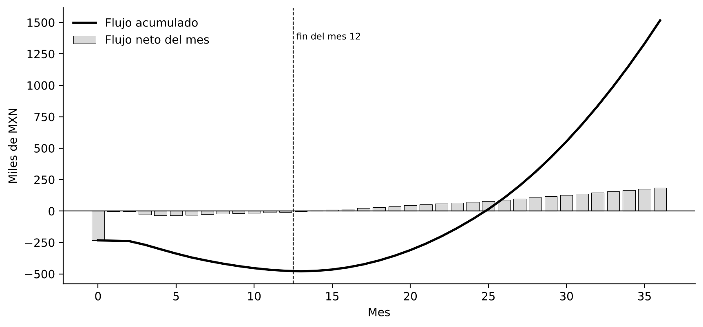

# Viabilidad técnica y económica

!!! info "Objetivo de la semana"
    Evaluar si Nervik puede convertirse en un producto económicamente sostenible, analizando su modelo de ingresos, costos de fabricación, desarrollo, inteligencia artificial y proyecciones financieras.

---

## 1. Introducción

Durante las semanas anteriores identificamos una oportunidad en el sector del transporte de carga, definimos la propuesta de valor de Nervik y desarrollamos su arquitectura técnica.

En esta semana nos enfocamos en responder una pregunta diferente: **¿es económicamente viable fabricar y comercializar nuestro producto?**

Para responderla fue necesario estudiar los costos de los componentes electrónicos, la manufactura, el desarrollo de software, la inteligencia artificial y la operación del servicio.

También analizamos modelos de ingresos utilizados por empresas similares y aplicamos herramientas financieras como el Valor Presente Neto (VPN) y la Tasa Interna de Retorno (TIR).

Los resultados se utilizaron para construir un escenario económico del proyecto.

---

## 2. Pertinencia, factibilidad y viabilidad

Antes de realizar los cálculos financieros, diferenciamos tres conceptos que forman parte de la evaluación de un producto.

| Concepto | Pregunta principal | Aplicación en Nervik |
|:---|:---|:---|
| Pertinencia | ¿Vale la pena desarrollar el producto? | Atender una necesidad relacionada con la pérdida de información durante incidentes |
| Factibilidad | ¿Podemos construirlo? | Desarrollar el hardware, firmware, sensores y aplicación |
| Viabilidad | ¿Puede sostenerse económicamente? | Comparar costos, ingresos, inversión y recuperación |

La pertinencia se abordó durante la investigación de usuarios y mercado.

La factibilidad se estudió mediante el PDS y las alternativas de diseño.

Finalmente, la viabilidad permite determinar si el modelo económico puede sostener el desarrollo y la comercialización de Nervik.

### 2.1 Dimensiones de viabilidad

El equipo consideró tres dimensiones principales:

**Viabilidad económica:** determinar los costos, ingresos, márgenes, punto de equilibrio y recuperación de la inversión.

**Viabilidad operativa:** analizar si la fabricación, el ensamble y las pruebas pueden realizarse con los recursos disponibles.

**Viabilidad legal:** identificar requisitos relacionados con comunicación celular, protección de datos y conservación de registros.

En el análisis operativo se consideró la fabricación y el ensamble de PCB mediante JLCPCB, acompañados de un dispositivo de prueba o *fixture*.

Se estimó un tiempo de aproximadamente **15 minutos de ensamble por unidad**, como objetivo de planeación.

En materia legal, la investigación del equipo identificó la necesidad de revisar la homologación del módem ante el IFT, las obligaciones de protección de datos y los criterios aplicables si los registros electrónicos se utilizan como evidencia.

---

## 3. Investigación de modelos de ingresos

Para elegir un modelo comercial se utilizó Perplexity como apoyo en una investigación comparativa de empresas relacionadas con telemática, seguridad y transporte.

El análisis buscó identificar:

- Quién paga por el servicio.
- Cuándo se realiza el pago.
- Cómo se estructura el precio.
- Qué dificultades existen para adquirirlo.
- Qué otros participantes podrían beneficiarse del producto.

### 3.1 Comparación de empresas

| Empresa | Modelo comercial | Precio de referencia | Aspecto relevante |
|:---|:---|:---|:---|
| Motive | Suscripción mensual por vehículo, con hardware incluido | Aproximadamente US$35 al mes | Contrato anual |
| Geotab | Hardware vendido o prestado y plataforma SaaS | Hardware US$80–120; servicio US$30–40 al mes | Integración y configuración |
| Detecta Security | Cobro por servicio de custodia o por ruta | $8,000–45,000 MXN por ruta | Costo asociado a cada traslado |

*Los valores corresponden al benchmarking documentado por el equipo; no representan cotizaciones comerciales vigentes.*

### 3.2 Modelo predominante

El análisis permitió identificar que las plataformas de telemática utilizan principalmente un esquema de:

**Hardware + suscripción mensual por vehículo.**

Este modelo permite relacionar el precio con el número de unidades que tiene una transportista.

También permite mantener ingresos recurrentes para cubrir conectividad, almacenamiento, soporte y actualizaciones.

### 3.3 Oportunidad de otro comprador

Durante la investigación se identificó a las aseguradoras de carga como un posible participante adicional.

La hipótesis del equipo consiste en que una aseguradora podría encontrar valor en recibir expedientes de incidentes con información registrada localmente.

Sin embargo, todavía es necesario validar si estaría dispuesta a pagar por esa función o reconocer los registros generados por Nervik.

---

## 4. Modelo de ingresos seleccionado

Después de comparar las alternativas, se propuso comercializar Nervik mediante la venta del dispositivo y una suscripción mensual.

| Concepto | Precio propuesto |
|:---|---:|
| Dispositivo instalado | **$1,800 MXN** |
| Suscripción mensual por unidad | **$300 MXN** |
| Suscripción anual por unidad | **$3,600 MXN** |
| Primer año, hardware y suscripción | **$5,400 MXN** |

La suscripción contempla la aplicación, conectividad, almacenamiento de información, expedientes y reportes.

### 4.1 Justificación del modelo

El hardware representa una inversión inicial para incorporar Nervik a una unidad.

La suscripción permite financiar los servicios que continúan utilizándose después de instalarlo.

El objetivo es que el cliente no pague únicamente por un dispositivo electrónico, sino por la capacidad de consultar y recuperar información relevante.

Un aspecto importante del modelo es que el expediente firmado se plantea como parte del servicio de suscripción.

Esto permite relacionar el cobro recurrente con una función específica del producto.

---

## 5. Análisis de costos de fabricación

Uno de los objetivos principales de la semana fue calcular cuánto costaría producir Nervik.

Para esta revisión se utilizó la arquitectura del PDS y no solamente la lista preliminar de componentes de semanas anteriores.

Andrik documentó una cotización realizada el **30 de octubre de 2026**, utilizando un tipo de cambio de referencia de **$18.65 MXN por dólar**.

### 5.1 Lista preliminar de componentes

| Componente | Referencia | Precio USD a 100 unidades | Proveedor considerado |
|:---|:---|---:|:---|
| Microcontrolador | RP2040 | $0.76 | LCSC |
| Controlador CAN | MCP2515 | $1.05 | LCSC |
| Transceptor CAN aislado | ISO1042 | $1.60 | LCSC |
| IMU | LSM6DSOX | $1.66 | LCSC |
| Módem celular | Quectel BG95-M3 | $19.91 | Mouser / Findchips |
| Receptor GNSS | Quectel LC76G | $5.48 | Avnet |
| Cable J1939 | Deutsch de 9 pines | $7.68 | Alibaba |
| SIM IoT | 1NCE | $16.00 | 1NCE |
| Componentes restantes | Flash, energía, batería, LED, pasivos y antenas | ≈ $9.98 | Varios |

La tabla corresponde al escenario de cotización estudiado por el equipo para una producción de 100 unidades.

### 5.2 Resultados de la cotización

En el análisis se reportó un costo de **$754 MXN en componentes por unidad** para el lote de 100 piezas, considerado frente al requisito C-01 del PDS.

Este valor excede en **$104 MXN** la meta de componentes establecida en la especificación.

El módem celular se identificó como uno de los componentes de mayor costo.

También se detectó un posible problema de disponibilidad, ya que el Quectel BG95-M3 podía presentar plazos de entrega de hasta 16 semanas, superiores al objetivo de ocho semanas del proyecto.

### 5.3 Costo unitario completo

Además de los componentes, se consideraron manufactura, carcasa, ensamble, costos indirectos y contingencias.

| Concepto | Costo por unidad |
|:---|---:|
| BOM puesto en México | $1,375 MXN |
| PCB, PCBA y envío | $73 MXN |
| Carcasa | $45 MXN |
| Ensamble y prueba | $30 MXN |
| Costos indirectos | $228 MXN |
| Contingencias | $344 MXN |
| **Total estimado** | **$2,095 MXN** |

El análisis presenta dos escenarios:

- **Lote de 10 unidades:** $2,662 MXN por unidad.
- **Lote de 100 unidades:** $2,095 MXN por unidad.

La diferencia se relaciona con el volumen de compra y las condiciones de fabricación.

El valor de $754 corresponde a una referencia de componentes utilizada en el análisis del requisito C-01, mientras que el costo total incluye categorías adicionales y una BOM puesta en México.

---

## 6. Clasificación de costos D/F/S

Durante la clase se utilizó una clasificación de costos inspirada en la metodología IDEO.

Esta herramienta permite distinguir entre aquellos gastos que generan diferenciación y los que pueden ajustarse sin modificar la propuesta principal.

### 6.1 Categorías

| Categoría | Significado | Aplicación en Nervik |
|:---|:---|:---|
| D — Diferenciación | Costos directamente relacionados con el valor del producto | TinyML, análisis multiseñal y bitácora firmada |
| F — Flexibles | Costos que pueden reducirse, sustituirse o negociarse | Selección del módem celular |
| S — Establecidos | Costos asociados a tarifas o servicios externos | PCB, nube, servicios de IA, cable y SIM |

### 6.2 Interpretación

El equipo identificó que los costos de diferenciación deben mantenerse relacionados con el beneficio principal del producto.

En cambio, los costos flexibles representan oportunidades para disminuir el precio sin eliminar funciones esenciales.

El módem celular resultó especialmente importante porque representa una parte significativa del costo electrónico.

Por ello, comparar alternativas de comunicación puede ser una estrategia relevante para mejorar la viabilidad económica.

---

## 7. Costo de la inteligencia artificial

Una de las preguntas de la semana fue cuánto costaría utilizar inteligencia artificial como parte de los servicios de Nervik.

En la arquitectura propuesta, el análisis principal de las señales se ejecuta localmente mediante TinyML.

Por lo tanto, la inferencia local no requiere realizar una llamada pagada a un servicio de IA cada vez que se analizan los sensores.

Las llamadas a un modelo externo se reservarían para tareas como procesamiento y generación de reportes.

### 7.1 Supuestos del cálculo

Se documentó un prompt representativo de 2,168 caracteres, con información de telemetría y eventos.

Para estimar el costo se consideraron los siguientes parámetros:

| Parámetro | Valor |
|:---|---:|
| Tokens de entrada | 900 |
| Tokens de salida | 600 |
| Llamadas por unidad al día | 1.34 |
| Días por mes | 30 |
| Precio por millón de tokens de entrada | US$0.10 |
| Precio por millón de tokens de salida | US$0.50 |

### 7.2 Resultado

El costo mensual se estimó mediante:

**Costo mensual = llamadas diarias × costo de tokens por llamada × 30 días.**

Resultado:

**US$0.0157 por unidad al mes.**

Convertido a pesos, el documento del equipo reporta aproximadamente:

**$0.29 MXN por unidad al mes.**

Para 100 dispositivos activos, el costo estimado sería de aproximadamente **$29 MXN mensuales**.

### 7.3 Interpretación

El análisis mostró que el costo de las llamadas de IA no es el principal problema económico del proyecto, bajo los supuestos utilizados.

La arquitectura Edge AI también ayuda a limitar las solicitudes externas porque el procesamiento principal ocurre dentro del dispositivo.

Sin embargo, el resultado depende del volumen real de eventos, las funciones utilizadas y las tarifas de los servicios de IA.

---

## 8. Costos de desarrollo y ciclos de aprendizaje

Además del hardware, se estimó el costo de los ciclos necesarios para desarrollar y validar el producto.

Un ciclo de aprendizaje puede incluir construcción, programación, pruebas, análisis de errores y modificaciones.

### 8.1 Costos estimados por ciclo

| Concepto | Costo |
|:---|---:|
| Costos directos | $25,958 MXN |
| Costos con 15% de indirectos | $29,851 MXN |
| Contingencia considerada | 30% |

### 8.2 Escenarios de desarrollo

| Escenario | Ciclos de aprendizaje | Costo total |
|:---|---:|---:|
| Mínimo | 3 | $116,420 MXN |
| **Promedio** | **6** | **$232,840 MXN** |
| Máximo | 8 | $310,454 MXN |

El equipo seleccionó el escenario promedio como referencia de presupuesto.

Esto permite reconocer que un producto no suele llegar a su versión funcional definitiva en el primer intento.

En el desarrollo de Nervik será necesario probar componentes, corregir conexiones, ajustar el procesamiento y verificar el funcionamiento en diferentes condiciones.

---

## 9. Matemáticas financieras

Durante la clase también se revisaron herramientas que permiten comparar inversiones y evaluar la recuperación del dinero a través del tiempo.

Los principales conceptos fueron:

- Valor Presente (VP).
- Valor Presente Neto (VPN).
- Tasa Interna de Retorno (TIR).
- Flujo de caja.
- Análisis de sensibilidad.

### 9.1 Valor Presente Neto

El VPN permite evaluar si los flujos futuros de un proyecto compensan la inversión inicial considerando una tasa de descuento.

De manera general:

**VPN = Valor presente de los flujos futuros − inversión inicial.**

Si el VPN es positivo, el proyecto supera la tasa de descuento utilizada en el cálculo.

Si es negativo, no alcanza el rendimiento exigido bajo esos supuestos.

### 9.2 Ejercicios financieros

Durante la actividad se trabajaron los ejercicios 4 a 9.

| Ejercicio | Resultado documentado | Interpretación |
|:---|:---|:---|
| 4 | VPN = +$3,832 | Aceptable con margen pequeño |
| 5 | VPN = +$7,456 | Viable según la tasa utilizada |
| 6 | VPN = +$151,083 | Viable |
| 7 | Proyecto X: +$14,427; Y: +$12,128 | Se prefiere X |
| 8 | Cambio de signo entre tasas de 20% y 25% | TIR aproximada de 23.4% |
| 9 | TIR aproximada de 18.2% | Superior a la tasa mínima de 14% |

### 9.3 Sensibilidad del proyecto X

En el ejercicio 8 se analizó cómo cambia el VPN del proyecto X al modificar la tasa de descuento.

| Tasa de descuento | VPN aproximado |
|:---|---:|
| 8% | +$14,427 |
| 15% | +$7,081 |
| 20% | +$2,662 |
| 25% | −$1,200 |

El resultado muestra que la decisión de inversión depende de la tasa de descuento considerada.

Cuando la tasa aumenta, disminuye el valor presente de los flujos futuros.

En este ejercicio, la TIR aproximada fue de 23.4%.

---

## 10. Modelo económico de Nervik

Después de revisar los costos y los ejercicios financieros, el equipo utilizó Claude como apoyo para construir una proyección económica del negocio.

El modelo consideró:

- Precio de venta del dispositivo.
- Suscripción mensual.
- Costo unitario.
- Costos operativos.
- Volumen de ventas.
- Inversión de desarrollo.
- Flujo de caja.
- Punto de equilibrio.
- Valor Presente Neto.

### 10.1 Métodos de precio

Se utilizaron dos enfoques.

**Cost-plus:** establecer un precio a partir de los costos y el margen requerido.

**Value-based:** estimar cuánto podría justificar el cliente con base en el beneficio recibido.

| Método | Resultado |
|:---|:---|
| Cost-plus con margen de 40% | Hardware: $2,934 MXN |
| Piso de suscripción calculado | $83 MXN mensuales |
| Value-based con ahorro hipotético de custodia | Hasta $454 MXN mensuales |
| Value-based sin ese supuesto | Aproximadamente $37 MXN mensuales |
| **Precio comercial propuesto** | **$1,800 instalado + $300 al mes** |

El resultado muestra que el precio propuesto del hardware es inferior al valor calculado mediante cost-plus.

Por lo tanto, la suscripción y la permanencia de los clientes tienen una función importante en la recuperación de los costos.

### 10.2 Punto de equilibrio

El análisis económico reportó dos referencias:

- **154 unidades-año**, de acuerdo con el escenario modelado.
- **123 suscripciones activas** para cubrir los costos de operación.

Estos resultados dependen de los supuestos de ventas, costos variables y gastos operativos.

### 10.3 Flujo de caja y VPN

El análisis financiero se realizó para distintos horizontes de tiempo.

| Indicador | Resultado |
|:---|---:|
| VPN a 12 meses, tasa de 15% | **−$458,058 MXN** |
| Acumulado mínimo | −$475,271 MXN |
| VPN a 36 meses | **+$962,058 MXN** |
| Primer mes con flujo positivo | Mes 14 |
| Recuperación de inversión | Alrededor del mes 25 |

Los resultados muestran una diferencia importante entre la viabilidad de corto y largo plazo.

Durante el primer año, la inversión inicial y los costos de desarrollo impiden recuperar el dinero.

En el escenario de 36 meses, el modelo proyecta un VPN positivo, siempre que se cumplan los supuestos de ventas, permanencia y precios.

### 10.4 Gráfica del flujo de caja

*Figura 1. Flujo de caja mensual y acumulado del escenario de Nervik a 36 meses.*

La gráfica permite identificar los periodos con pérdidas y el momento aproximado en que la inversión comenzaría a recuperarse.

---

## 11. Principales riesgos económicos

Al concluir el análisis se identificaron varios aspectos que condicionan la viabilidad del proyecto.

| Riesgo | Consecuencia |
|:---|:---|
| Costo elevado del módem | Aumenta el BOM electrónico |
| Precio de hardware inferior al costo unitario | Se requiere recuperar parte del costo con ingresos posteriores |
| Dependencia de la suscripción | La permanencia de clientes es fundamental |
| Reconocimiento del expediente por aseguradoras | Afecta la justificación del precio propuesto |
| Plazo de entrega de componentes | Puede retrasar fabricación y ventas |
| Inversión inicial | Requiere financiamiento antes de alcanzar flujo positivo |

El análisis plantea que podrían necesitarse aproximadamente **$480,000 MXN de financiamiento** durante la etapa inicial.

También se propusieron alternativas para mejorar el modelo, como negociar con aseguradoras, utilizar funciones integradas del módem y obtener clientes iniciales con pagos anticipados.

Estas medidas forman parte de las posibilidades estudiadas y no deben interpretarse como acuerdos comerciales ya realizados.

---

## 12. Resultados de la semana

| Actividad | Resultado |
|:---|:---|
| Análisis de viabilidad | Evaluación económica, operativa y legal |
| Benchmarking comercial | Tres empresas comparadas |
| Modelo de ingresos | Hardware + suscripción mensual |
| Precio propuesto | $1,800 + $300 al mes |
| BOM cotizado | Componentes y proveedores identificados |
| Costo unitario | $2,662 a 10 unidades y $2,095 a 100 |
| Costos D/F/S | Identificación de diferenciación, flexibilidad y costos establecidos |
| Costo de IA | Aproximadamente $0.29 MXN al mes por unidad |
| Ciclos de aprendizaje | Escenario promedio de seis ciclos |
| Ejercicios financieros | VPN, TIR y sensibilidad |
| VPN de Nervik a 12 meses | Negativo |
| VPN de Nervik a 36 meses | Positivo bajo los supuestos del modelo |

---

## Conclusión

Durante la Semana 7 evaluamos la viabilidad técnica y económica de Nervik.

El equipo definió un modelo de ingresos basado en la venta del dispositivo y una suscripción mensual.

También se analizaron los costos electrónicos, la manufactura, el desarrollo, la inteligencia artificial y los ciclos de aprendizaje necesarios para llevar el producto a una etapa comercial.

Los resultados indican que el escenario financiero no recupera la inversión durante el primer año, pero proyecta una recuperación posterior y un VPN positivo a 36 meses.

La viabilidad depende de validar las hipótesis comerciales, mejorar el costo de los componentes y conseguir clientes que reconozcan el valor del registro local de eventos.

La siguiente etapa consistirá en trasladar estas decisiones al prototipo físico, revisar la manufacturabilidad y comprobar qué funciones pueden demostrarse mediante pruebas reales.

---
