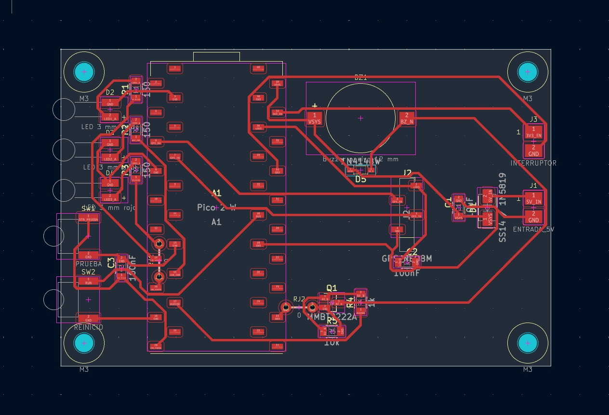

# Prototipado y diseño para manufactura

### Adaptación del diseño para la demostración final

Durante el desarrollo de Nervik se planteó inicialmente una PCB que integrara todos los elementos necesarios para su futura implementación en vehículos de transporte de carga. Este diseño contemplaba la conexión con el sistema eléctrico de un camión, la lectura de información mediante CAN/J1939, el monitoreo GNSS, la comunicación celular y un sistema de alimentación con respaldo de batería.

Sin embargo, para la presentación final del proyecto no contamos con un camión en el que podamos instalar el dispositivo y comprobar su funcionamiento bajo condiciones reales de operación.

Por este motivo, desarrollamos una **PCB específica para el prototipo funcional**, con la que podemos representar y demostrar las funciones principales de Nervik en un entorno controlado, sin depender de la instalación en un vehículo de carga.

Esta placa utiliza una entrada de alimentación de 5 V, que permite realizar las pruebas con una fuente regulada. De esta manera, podemos encender el dispositivo y demostrar la respuesta del microcontrolador, los indicadores luminosos, las alertas audibles y los controles físicos.

La diferencia principal es que la PCB de demostración reproduce las funciones necesarias para presentar el sistema, mientras que la versión automotriz contempla la electrónica adicional requerida para instalarlo posteriormente en un camión.

Esto nos permite mostrar una implementación física del proyecto y explicar cómo podría adaptarse a las condiciones de operación del transporte de carga.

### PCB desarrollada para el prototipo

*Figura. Diseño de la PCB desarrollada en KiCad para el prototipo funcional de Nervik.*

### Componentes principales de la PCB

La placa fue diseñada alrededor de una Raspberry Pi Pico W, encargada de ejecutar el programa y controlar los diferentes componentes del sistema.

| Componente | Función |
|:---|:---|
| Raspberry Pi Pico W | Procesa las señales y controla el funcionamiento del dispositivo |
| Entrada de alimentación de 5 V | Permite utilizar una fuente externa regulada |
| Interruptor de encendido | Controla la alimentación del circuito |
| Tres LED indicadores | Muestran los estados de alimentación, comunicación y alerta |
| Resistencias | Limitan la corriente y permiten el control adecuado de diferentes señales |
| Buzzer | Emite una alerta audible cuando el programa lo indica |
| Transistor | Permite controlar la activación del buzzer desde la Pico W |
| Capacitores | Ayudan a estabilizar la alimentación del circuito |
| Diodos | Forman parte de los circuitos de protección y control |
| Botón de prueba | Permite activar una prueba de funcionamiento |
| Botón de reinicio | Reinicia el microcontrolador |
| Orificios de montaje | Permiten fijar la placa dentro de la carcasa |

### Funcionamiento del prototipo

El funcionamiento comienza al conectar una fuente regulada de 5 V a la entrada de alimentación de la placa.

Una vez energizado el sistema, la Raspberry Pi Pico W ejecuta el firmware encargado de controlar los indicadores y responder a las señales de entrada.

Los tres LED permiten identificar visualmente diferentes condiciones:

- **Alimentación:** indica que el dispositivo está encendido.
- **Comunicación:** representa el estado de conectividad.
- **Alerta:** se activa cuando se genera una condición de advertencia.

La PCB también incorpora un buzzer que permite generar alertas audibles. Este componente se controla mediante un transistor, evitando que el microcontrolador tenga que alimentar directamente la carga.

El botón de prueba permite ejecutar una función de comprobación sin necesidad de generar una situación de riesgo real. Esto es especialmente útil durante la presentación, ya que podemos mostrar cómo responde el dispositivo ante una condición de prueba.

Por otra parte, el botón de reinicio permite reiniciar la Pico W y ejecutar nuevamente el programa.

La conectividad Wi-Fi de la Pico W permite incorporar la comunicación con la aplicación de Nervik, de acuerdo con las funciones implementadas en el firmware.

### Diferencias entre ambas versiones

| Característica | PCB del prototipo | PCB para aplicación en camiones |
|:---|:---|:---|
| Alimentación | 5 V regulados | Sistema eléctrico vehicular de 12/24 V |
| Microcontrolador | Raspberry Pi Pico W | Arquitectura de procesamiento integrada |
| Indicadores | Tres LED | Indicadores de estado |
| Alertas | Buzzer | Sistema de alertas |
| Controles | Prueba y reinicio | Prueba, reinicio y funciones de servicio |
| Comunicación | Wi-Fi mediante Pico W | Comunicación celular LTE |
| Sensado | Integración de módulos externos | GNSS e IMU integrados |
| Información del vehículo | No requiere conexión a un camión | Lectura CAN/J1939 |
| Batería de respaldo | No incluida en esta placa | Sistema de respaldo previsto |
| Entorno de prueba | Laboratorio | Vehículo de transporte de carga |

### Desarrollo y resultado obtenido

Como resultado de este proceso, **desarrollamos en KiCad una PCB adaptada a las condiciones de nuestra demostración final**.

El diseño integra el microcontrolador, los circuitos de alimentación, los indicadores, el buzzer y los botones de control en una misma placa.

Esto representa un avance respecto al uso de conexiones temporales, ya que permite organizar los componentes y establecer una distribución física específica para el prototipo.

La placa constituye la base electrónica de la demostración, mientras que la integración con los módulos externos y la aplicación permite representar las funciones adicionales del sistema.

### Conclusión

El desarrollo de esta PCB permitió adaptar Nervik a las condiciones de la presentación final sin perder de vista su aplicación futura en vehículos de carga.

Aunque no contamos con un camión para realizar las pruebas, la versión de demostración permite mostrar físicamente el dispositivo, su procesamiento y la respuesta de sus componentes ante eventos de prueba.

El diseño automotriz completo se conserva como referencia para una implementación posterior, en la que se incorporarían la alimentación vehicular, el monitoreo CAN/J1939, la comunicación LTE y el respaldo de energía.

De esta manera, el proyecto cuenta con un diseño electrónico específico para demostrar su funcionamiento en laboratorio y una arquitectura más completa para su futura aplicación en el transporte de carga.