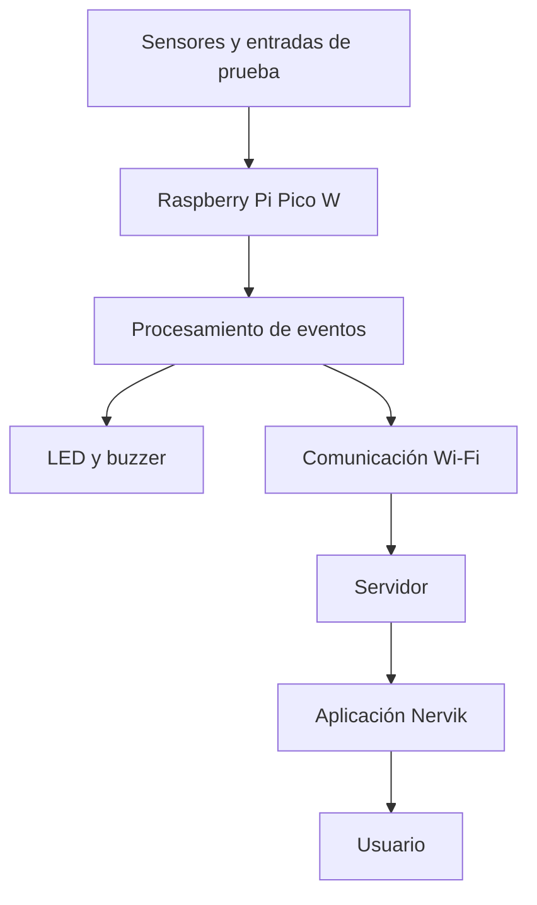
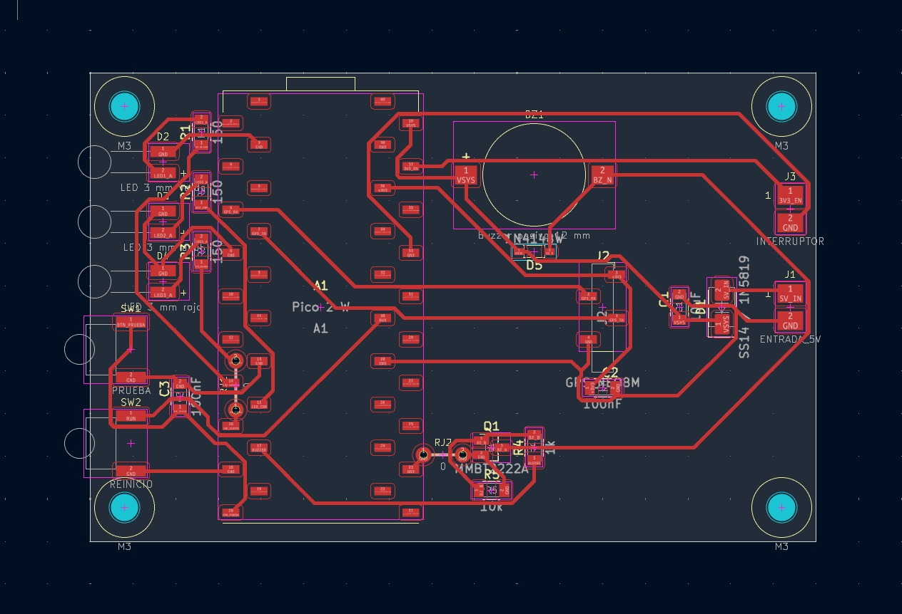

# Integración, go-to-market y pitch

!!! info "Objetivo de la semana"
    Integrar los avances del desarrollo de Nervik, relacionando el diseño electrónico con la aplicación, la carcasa y el modelo de negocio, para presentar una propuesta de producto que responda al problema identificado durante el semestre.

---

## 1. Introducción

Durante las semanas anteriores desarrollamos diferentes aspectos de Nervik: la investigación del problema, el análisis de mercado, la definición de requisitos, la selección del concepto físico, el estudio de viabilidad y el diseño electrónico.

En esta última etapa nos enfocamos en reunir esos elementos para mostrar cómo se relacionan entre sí y cómo podrían funcionar como un producto completo.

Uno de los principales retos fue conectar el desarrollo técnico con la propuesta de valor. No bastaba con presentar una PCB, una carcasa o una aplicación de manera independiente; era necesario explicar qué función cumple cada elemento y cómo contribuye al objetivo de Nervik.

También trabajamos en la preparación de la presentación final, especialmente en la construcción de un pitch que comunicara el problema y la solución sin depender de explicaciones demasiado técnicas.

---

## 2. Integración de los elementos de Nervik

Nervik es un sistema orientado a detectar y registrar condiciones anómalas relacionadas con la comunicación y ubicación de vehículos de transporte de carga.

Su arquitectura contempla la integración de sensores, procesamiento local, comunicación, almacenamiento y una aplicación de monitoreo.

Durante el desarrollo del proyecto trabajamos en diferentes partes de esta arquitectura.

### 2.1 Componentes del sistema

| Elemento | Desarrollo dentro del proyecto | Función |
|:---|:---|:---|
| PCB | Diseño electrónico desarrollado en KiCad | Integrar el microcontrolador y los circuitos |
| Microcontrolador | Raspberry Pi Pico W | Ejecutar el firmware y controlar periféricos |
| Indicadores | Tres LED | Representar los estados del dispositivo |
| Alerta audible | Buzzer | Señalizar un evento de prueba o advertencia |
| Controles | Botones de prueba y reinicio | Permitir interacción con el dispositivo |
| Carcasa | Concepto Cuña Guardián | Proteger y organizar los componentes |
| Aplicación | Interfaz desarrollada por el equipo | Visualizar información y alertas |
| Página web | Presentación digital de Nervik | Comunicar el producto y su propuesta de valor |

Estos elementos representan diferentes partes de un mismo sistema.

El desarrollo de cada uno también permitió identificar las necesidades de integración que deben resolverse antes de utilizar Nervik en condiciones reales.

### 2.2 Relación entre hardware y software

La Raspberry Pi Pico W es el elemento central del prototipo electrónico.

Su función es ejecutar el firmware, recibir las entradas disponibles y controlar los indicadores y las alertas.

La arquitectura de Nervik también contempla el envío de información mediante Wi-Fi hacia un servidor, para que posteriormente pueda visualizarse en la aplicación.

El funcionamiento completo depende de que las señales puedan pasar correctamente entre cada etapa.

*Figura 1. Arquitectura de integración del prototipo de Nervik.*

Este diagrama representa la relación prevista entre los componentes electrónicos y digitales del sistema.

---

## 3. Desarrollo de la PCB para la demostración

Una de las decisiones más importantes del desarrollo fue adaptar el diseño electrónico a las condiciones disponibles para la presentación final.

Inicialmente trabajamos en una arquitectura de PCB que contemplaba los elementos necesarios para una futura instalación en camiones.

Esta versión incluía alimentación automotriz, comunicación celular, GNSS, IMU y lectura del bus CAN/J1939.

Sin embargo, durante la presentación académica no contaremos con un camión para conectar el dispositivo y reproducir sus condiciones reales de operación.

Por esta razón, desarrollamos una PCB específica para la demostración, alimentada mediante una fuente regulada de 5 V.

La intención fue disponer de una placa que permitiera representar físicamente el funcionamiento de Nervik y probar sus controles e indicadores sin depender de la instalación en un vehículo.

### 3.1 Diseño electrónico realizado

La PCB de demostración incorpora:

- Raspberry Pi Pico W.
- Entrada de alimentación de 5 V.
- Interruptor.
- Tres LED indicadores.
- Buzzer y transistor de control.
- Resistencias, capacitores y componentes auxiliares.
- Botón de prueba.
- Botón de reinicio.
- Orificios para fijación dentro de la carcasa.

La distribución de los componentes y las pistas se desarrolló utilizando KiCad.

*Figura 2. Diseño de la PCB de demostración desarrollado en KiCad.*

### 3.2 Función de la PCB

El prototipo utiliza la Raspberry Pi Pico W como unidad de procesamiento.

Los LED permiten representar diferentes estados del sistema, mientras que el buzzer proporciona una alerta audible.

El botón de prueba permite generar una interacción controlada durante la demostración y el botón de reinicio permite reiniciar el microcontrolador.

La alimentación de 5 V evita la necesidad de conectar la placa directamente a un sistema eléctrico automotriz.

### 3.3 Relación con la versión para camiones

La PCB de demostración y la versión automotriz responden a dos necesidades diferentes.

| Característica | Prototipo de demostración | Versión para camiones |
|:---|:---|:---|
| Alimentación | Fuente regulada de 5 V | Alimentación vehicular de 12/24 V |
| Procesamiento | Raspberry Pi Pico W | Arquitectura de procesamiento integrada |
| Indicadores | Tres LED | Indicadores de estado |
| Alerta audible | Buzzer | Sistema de alertas |
| Comunicación | Wi-Fi | Comunicación celular LTE |
| GNSS e IMU | Integración mediante módulos externos | Integración prevista en PCB |
| CAN/J1939 | No integrado en esta placa | Lectura de datos del vehículo |
| Batería | No integrada | Respaldo energético previsto |

La decisión de separar ambas versiones permitió continuar desarrollando la electrónica del producto sin depender de un vehículo real para mostrar el prototipo académico.

---

## 4. Integración con la carcasa Cuña Guardián

Durante la Semana 6 seleccionamos el concepto Cuña Guardián como propuesta física para Nervik.

Su diseño se caracteriza por una geometría compacta, superficies biseladas y una distribución pensada para integrar los elementos electrónicos.

La carcasa cumple una función importante porque convierte el conjunto de componentes en un dispositivo físico que puede instalarse y manipularse como un producto.

### 4.1 Relación con la electrónica

El diseño de la carcasa debe considerar:

- Dimensiones de la PCB.
- Ubicación de los indicadores LED.
- Espacio para el buzzer.
- Acceso a los botones.
- Entrada de alimentación.
- Puntos de montaje.
- Espacio disponible para los componentes.

La selección de Cuña Guardián permitió definir una dirección de diseño para el producto.

La PCB desarrollada para la demostración también permite estudiar la distribución de los componentes antes de avanzar hacia una versión electrónica más completa.

### 4.2 Experiencia de usuario

La interfaz física se mantiene sencilla.

Los tres LED permiten identificar estados relevantes sin necesidad de consultar constantemente una pantalla.

Los botones proporcionan una manera directa de interactuar con el dispositivo, especialmente durante el reinicio y las pruebas.

La aplicación complementa esta interfaz al permitir presentar información más detallada.

---

## 5. Integración de la aplicación

Otro elemento importante de Nervik es la aplicación desarrollada por el equipo.

Su propósito es que una persona encargada del monitoreo pueda consultar el estado de los dispositivos y reconocer situaciones que requieren atención.

Durante la definición de la interfaz se priorizaron dos situaciones:

**Funcionamiento normal:** consultar el estado de la flota e identificar las unidades que no presentan alertas.

**Situación de riesgo:** reconocer una unidad con una condición anómala y acceder a información relacionada con el evento.

### 5.1 Información de la aplicación

La interfaz propuesta contempla:

| Información | Utilidad |
|:---|:---|
| Estado general de la flota | Conocer la situación de las unidades |
| Identificación del vehículo | Reconocer qué unidad requiere atención |
| Nivel de alerta | Distinguir la prioridad de un evento |
| Última ubicación válida | Consultar información disponible |
| Estado de comunicación | Identificar interrupciones |
| Historial de eventos | Revisar lo ocurrido anteriormente |

El objetivo es presentar la información de manera clara para facilitar la interpretación de una alerta.

La aplicación y el hardware forman parte del mismo concepto, aunque la comunicación real entre ambos debe comprobarse mediante pruebas de integración.

---

## 6. Evaluación de la integración

Durante el desarrollo electrónico identificamos que integrar distintos componentes requiere revisar tanto las conexiones físicas como la interpretación de la información.

En KiCad utilizamos herramientas de comprobación eléctrica para identificar problemas dentro del esquemático.

Uno de los casos que enfrenté fue la importación de la biblioteca de la IMU LSM6DSOXTR.

El símbolo tenía propiedades eléctricas incorrectas en dos terminales GND, lo que generaba errores durante la comprobación ERC.

Después de corregir las propiedades, el número de errores reportados disminuyó de 98 a 96.

Este proceso permitió comprender que el diseño electrónico también requiere validar las bibliotecas y no únicamente conectar componentes.

### 6.1 Aspectos identificados

| Área | Aspecto relevante |
|:---|:---|
| Alimentación | Utilizar tensiones compatibles con los componentes |
| Sensores | Verificar conexiones y protocolos |
| Comunicación | Confirmar que los mensajes lleguen correctamente |
| Procesamiento | Interpretar entradas y generar estados |
| Interfaz física | Comprobar la respuesta de indicadores y botones |
| Aplicación | Mostrar información consistente con el dispositivo |

### 6.2 Estado de la integración

El desarrollo ha permitido definir la arquitectura y avanzar en los componentes electrónicos y digitales de Nervik.

Sin embargo, es importante distinguir el diseño de una función de su validación.

La comprobación de alertas, comunicaciones y funcionamiento continuo requiere registrar las pruebas realizadas sobre el prototipo físico.

Esto es especialmente importante para las funciones de detección de interferencias y almacenamiento local, ya que su desempeño deberá demostrarse en condiciones controladas.

---

## 7. Modelo de negocio y lanzamiento

El desarrollo comercial de Nervik se relaciona con la necesidad de ofrecer una solución útil para las empresas de transporte de carga.

Durante la Semana 4 identificamos como segmento inicial a las empresas mexicanas con flotas medianas que operan en corredores de riesgo.

Nuestra propuesta de valor consiste en conservar información que pueda ayudar a comprender lo ocurrido cuando se interrumpe la comunicación de un vehículo.

### 7.1 Modelo comercial propuesto

El equipo seleccionó un esquema de venta de hardware acompañado por una suscripción mensual.

| Concepto | Precio propuesto |
|:---|---:|
| Dispositivo instalado | $1,800 MXN |
| Suscripción mensual | $300 MXN |
| Suscripción anual | $3,600 MXN |

La suscripción se relaciona con la disponibilidad de servicios de monitoreo, almacenamiento y consulta de información.

Estos precios corresponden al modelo económico propuesto durante la Semana 7 y todavía requieren validación con clientes.

### 7.2 Análisis económico

El escenario de fabricación estudiado durante la Semana 7 estimó un costo de aproximadamente $2,095 MXN por unidad en un lote de 100 piezas.

Esto representa una diferencia inicial de $295 MXN entre el precio propuesto de instalación y el costo estimado por unidad.

| Concepto | Valor |
|:---|---:|
| Precio del dispositivo | $1,800 MXN |
| Costo estimado | $2,095 MXN |
| Diferencia inicial | −$295 MXN |

Por lo tanto, el modelo comercial depende de mantener ingresos recurrentes y controlar los costos operativos.

La investigación también mostró que el proyecto necesitaría una inversión inicial antes de generar un flujo de caja positivo.

### 7.3 Estrategia de lanzamiento

La propuesta comercial se orienta inicialmente a empresas de transporte que ya utilizan sistemas de rastreo y monitoreo.

Nervik no busca necesariamente reemplazar esas herramientas, sino agregar una función complementaria de registro y análisis local.

La página de lanzamiento permite presentar la propuesta de valor, explicar las características del producto y establecer contacto con posibles clientes.

El interés comercial y la disposición de pago deberán comprobarse mediante interacción real con empresas del sector.

---

## 8. Consideraciones para una futura comercialización

El desarrollo de un producto electrónico para transporte de carga también implica requisitos técnicos y legales.

En el caso de Nervik, estos aspectos son relevantes porque la arquitectura completa considera comunicación celular, almacenamiento de información de ubicación y conexión con sistemas del vehículo.

| Aspecto | Relación con Nervik |
|:---|:---|
| Homologación de radio | Comunicación celular y otros sistemas inalámbricos |
| Protección de datos | Almacenamiento de ubicación e información de usuarios |
| Seguridad eléctrica | Alimentación y protección de componentes |
| Normativa del producto | Requisitos aplicables a su comercialización |
| Propiedad intelectual | Uso de la marca y revisión de antecedentes |
| Licencias de software | Uso de bibliotecas y herramientas de desarrollo |
| Reparabilidad | Mantenimiento y sustitución de componentes |

El prototipo académico permite desarrollar y demostrar funciones, pero no sustituye las validaciones necesarias para instalar el producto en un vehículo real.

Estas consideraciones deberán revisarse durante una etapa posterior de desarrollo.

---

## 9. Preparación del pitch

Una de las actividades más importantes de la semana fue estructurar la presentación final de Nervik.

Para ello retomamos la información desarrollada durante el semestre:

- El problema identificado en el transporte de carga.
- La propuesta de valor.
- El segmento inicial de clientes.
- La arquitectura del producto.
- El avance del diseño electrónico.
- El modelo de negocio.
- Las etapas pendientes de validación.

El principal reto fue sintetizar toda esta información y comunicarla de una manera que pudiera comprenderse sin conocimientos especializados en electrónica.

La decisión fue comenzar con una situación que representara el problema del usuario, presentar después la solución y cerrar con la siguiente etapa del proyecto.

### 9.1 Mensaje central

**Cuando se pierde la comunicación, Nervik busca conservar la información que permite entender lo ocurrido.**

Este mensaje resume el problema y la función principal que diferencia nuestra propuesta.

---

## 10. Guion del pitch de Nervik

### Parte 1 — Impacto y problema

Imaginemos a una responsable de seguridad que monitorea una flota de transporte de carga. Una de sus unidades desaparece del mapa. Durante los siguientes minutos no sabe si atravesó una zona sin cobertura, si ocurrió una falla técnica o si enfrenta una situación de riesgo.

La empresa tiene un sistema de rastreo, pero precisamente cuando pierde comunicación es cuando más necesita información.

### Parte 2 — Solución y diferenciación

Para atender ese problema desarrollamos Nervik, un dispositivo que busca identificar anomalías y conservar registros locales aun cuando la conexión externa se interrumpa.

Nuestra propuesta combina información de posicionamiento, comunicación y datos del vehículo. A diferencia de depender exclusivamente del monitoreo remoto, Nervik plantea continuar analizando y registrando eventos dentro del propio dispositivo.

En la demostración mostraremos el funcionamiento alcanzado por nuestro prototipo.

### Parte 3 — Mercado y modelo

Nos dirigimos inicialmente a empresas mexicanas de transporte de carga con flotas medianas, especialmente aquellas que operan por corredores de riesgo.

En nuestro análisis de mercado trabajamos con un escenario de 46 mil unidades atendibles, basado en información sectorial y supuestos de segmentación.

El modelo comercial propuesto combina un precio de instalación de mil ochocientos pesos y una suscripción mensual de trescientos pesos por unidad.

### Parte 4 — Avance y validación

Durante el semestre definimos los requisitos del producto, desarrollamos su arquitectura y seleccionamos el concepto físico Cuña Guardián.

También diseñamos una PCB de demostración alimentada a cinco voltios, con Raspberry Pi Pico W, indicadores, buzzer y controles.

La versión automotriz incorpora otras funciones que todavía requieren validación, entre ellas la interfaz CAN/J1939, el respaldo energético y la comunicación LTE.

Nuestro siguiente reto es comprobar el desempeño completo del sistema en condiciones representativas.

### Parte 5 — Equipo

Somos un equipo de estudiantes de ingeniería que ha trabajado en el diseño electrónico, la carcasa, la aplicación y la documentación del producto, integrando distintas áreas para desarrollar Nervik.

### Parte 6 — Petición y cierre

El siguiente paso que proponemos es realizar un piloto con empresas transportistas para evaluar el registro de eventos, la integración con sistemas de monitoreo y su utilidad durante incidentes.

Porque cuando una unidad deja de comunicarse, también importa saber qué ocurrió antes, durante y después de la interrupción.

---

## 11. Presentación del prototipo

La demostración del producto permite complementar el pitch con los elementos físicos y digitales desarrollados durante el semestre.

Mientras el pitch explica el problema y el valor comercial, el prototipo muestra la implementación técnica que hemos trabajado.

### 11.1 Elementos de la demostración

| Elemento | Qué permite presentar |
|:---|:---|
| PCB de demostración | Diseño electrónico y distribución de componentes |
| Raspberry Pi Pico W | Unidad de procesamiento |
| LED | Estados visuales |
| Buzzer | Alertas audibles |
| Botones | Interacción y prueba |
| Carcasa | Presentación física del dispositivo |
| Aplicación | Visualización del sistema |
| Página web | Propuesta de valor y modelo comercial |

### 11.2 Secuencia de presentación

La presentación del prototipo se organizó alrededor de una situación de funcionamiento normal y una condición de alerta.

Primero se muestra el dispositivo y se explica el significado de sus indicadores.

Después se presenta la interacción mediante el botón de prueba, que permite representar una condición anómala sin necesidad de provocar un incidente real.

Finalmente se muestra cómo la información correspondiente puede representarse en la aplicación, de acuerdo con las funciones que se hayan integrado y comprobado.

La demostración permite explicar el alcance actual de Nervik y las funciones que se incorporarían en una versión automotriz completa.

### 11.3 Alcance de las pruebas

La condición generada mediante el botón corresponde a una prueba controlada del sistema.

No debe confundirse con una detección comprobada de inhibición de señal.

Del mismo modo, la integración de los sensores y la comunicación debe evaluarse con registros reales para confirmar su desempeño.

Esta distinción permite presentar el proyecto de manera técnica y transparente.

---

## 12. Relación entre el prototipo y el producto final

La presentación final muestra una etapa del desarrollo de Nervik, no un producto comercial completamente validado.

El prototipo permite representar las funciones de procesamiento, interfaz física y respuesta ante eventos.

La arquitectura completa contempla capacidades adicionales necesarias para una futura implementación en vehículos de transporte de carga.

| Etapa | Características |
|:---|:---|
| Prototipo académico | PCB de 5 V, Pico W, indicadores, botones y buzzer |
| Integración funcional | Sensores, firmware y comunicación con aplicación |
| PCB automotriz | GNSS, LTE, CAN/J1939 y alimentación vehicular |
| Validación en campo | Pruebas reales de desempeño y fiabilidad |
| Producto comercial | Manufactura, certificaciones y soporte |

Esta evolución permite comprender cómo un prototipo desarrollado en un entorno universitario puede servir como punto de partida para un producto más completo.

---

## 13. Resultados de la semana

| Área | Resultado del desarrollo |
|:---|:---|
| Arquitectura | Relación entre hardware, procesamiento y aplicación |
| PCB | Diseño específico para demostración de laboratorio |
| Carcasa | Concepto Cuña Guardián |
| Interfaz física | Tres LED, botones y buzzer |
| Aplicación | Propuesta de visualización y monitoreo |
| Mercado | Segmento inicial de flotas medianas |
| Modelo comercial | Hardware y suscripción |
| Lanzamiento | Propuesta de valor y página web |
| Pitch | Guion estructurado |
| Validación | Identificación de funciones que requieren pruebas adicionales |

---

## Conclusión

La Semana 9 permitió reunir los avances desarrollados durante el semestre y preparar la presentación final de Nervik.

La integración del proyecto relaciona la PCB, el microcontrolador, la carcasa, la aplicación y el modelo de negocio.

El diseño de una placa específica para la demostración permitió adaptar el hardware a las condiciones disponibles, sin abandonar la propuesta de una versión completa para vehículos de carga.

También se consolidó el mensaje principal del producto: conservar información relevante cuando se interrumpe la comunicación de un vehículo.

El siguiente paso será continuar con las pruebas funcionales y la validación técnica, para determinar qué tan bien cumple Nervik los objetivos definidos en su PDS.

---